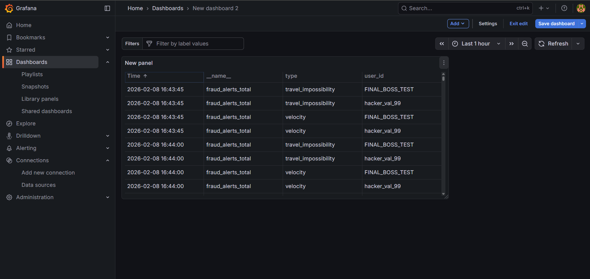
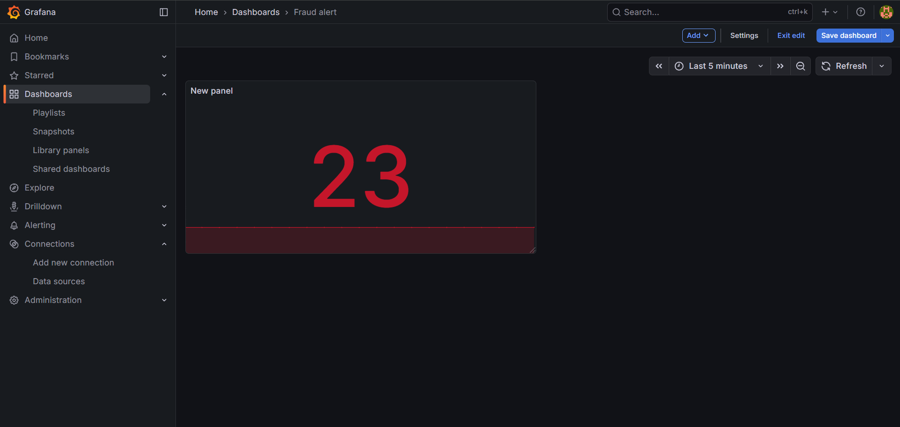
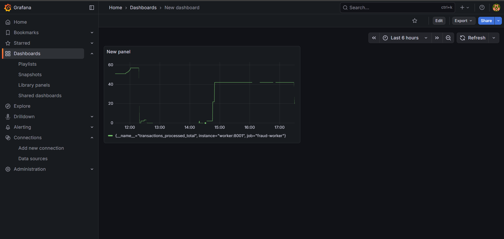

# Real-Time Fraud Detection Pipeline

A distributed, event-driven system that ingests financial transactions at high throughput, evaluates them against fraud rules in a streaming worker, and stores per-user state in Redis. All detection thresholds are stored in Redis and reloaded on every message — a Claude-powered CLI agent reads live alert metrics, reasons over them, and proposes threshold adjustments that take effect immediately without restarting the worker.

## Architecture

```
                        ┌─────────────────────────────────────────────┐
                        │              Traffic / Load Test             │
                        │                   Locust                     │
                        └───────────────────┬─────────────────────────┘
                                            │ HTTP POST /api/v1/ingest
                                            ▼
                                      ┌──────────┐
                                      │  FastAPI  │
                                      └─────┬─────┘
                                            │ produce
                                            ▼
                                      ┌──────────┐
                                      │  Kafka   │  pending-transactions
                                      └─────┬─────┘
                                            │ consume
                                            ▼
                              ┌─────────────────────────┐
                              │     Fraud Worker         │
                              │  (Python / aiokafka)     │
                              └────────────┬────────────┘
                                           │ read state + thresholds
                                           │ write alerts + counters
                                           ▼
                                      ┌──────────┐
                              ┌──────▶│  Redis   │◀──────┐
                              │       └──────────┘       │
                              │                          │
                    read alert metrics             write accepted
                              │                     thresholds
                              │                          │
                    ┌─────────┴──────────────────────────┴──────────┐
                    │          Threshold Tuner Agent                  │
                    │   Claude claude-opus-4-8 + tool use + CLI      │
                    └────────────────────────────────────────────────┘
                              │
                        Hot reload: worker reads fraud:thresholds
                        on every message — no restart needed
```

## Fraud Rules

All thresholds are stored in the Redis hash `fraud:thresholds` and read per-message. Defaults apply if the key is absent.

| Rule | Logic | Default threshold |
|---|---|---|
| Block-list | User ID in `banned_users` set | — |
| Geographic impossibility | Distance between consecutive transactions | 500 km |
| Spending spike | Transaction vs. rolling average of last 5 | 5× average |
| Velocity | Transactions in a 60-second sliding window | 5 tx / 60 s |

## Agentic Threshold Tuner

`agent/threshold_tuner.py` uses Claude with tool use to reason over live alert metrics and propose threshold changes. It calls two tools against Redis:

- **`get_fraud_metrics`** — reads current threshold values, per-rule alert counts, and total transaction volume
- **`propose_threshold_change`** — emits a structured proposal (no writes; human approves first)

The CLI then presents each proposal and writes accepted values back to `fraud:thresholds`. The worker picks them up on the next transaction.

**Run it:**
```bash
# Against Claude (requires ANTHROPIC_API_KEY)
python agent/threshold_tuner.py

# Dry run — no API call, hardcoded proposals
python agent/threshold_tuner.py --mock
```

**Example session:**
```
Running threshold tuning agent...

Proposal 1/2
  Threshold      : velocity_limit
  Current value  : 5
  Proposed value : 8
  Rationale      : Velocity alerts account for 38% of all alerts but transaction
                   volume is within normal range. The threshold is too tight for
                   legitimate burst patterns. Raising to 8 reduces noise while
                   still catching true rapid-fire abuse.

  Accept or reject? [a/r]: a
  Accepted — fraud:thresholds[velocity_limit] = 8

Proposal 2/2
  Threshold      : geo_distance_km
  Current value  : 500
  Proposed value : 300
  Rationale      : Travel impossibility alerts are near-zero despite high volume,
                   suggesting the 500 km limit is too permissive. Lowering to
                   300 km tightens coverage without materially increasing alert rate.

  Accept or reject? [a/r]: r
  Rejected.

Done. 1/2 proposal(s) applied to Redis.
```

## Load Test Results

Measured with Locust against a local stack (FastAPI + Kafka + Redis, Docker Compose).

| Metric | Result |
|---|---|
| Peak RPS | 440 |
| Total requests | 11,198 |
| Failures | 0 |
| Latency p50 | 56 ms |

## Monitoring

Prometheus scrapes the worker on `:8001`. Grafana dashboards:

**Security audit log** — per-user fraud type breakdown  


**Detection volume** — total alerts in the current window  


**System throughput** — worker heartbeat and event rate  


## Setup

**Prerequisites:** Docker, Docker Compose, Python 3.11+

```bash
# 1. Start infrastructure (Kafka, Redis, Prometheus, Grafana)
docker compose up -d

# 2. Install dependencies
pip install -r requirements.txt

# 3. Start the fraud detection worker
python -m app.services.fraud_detector

# 4. Start the FastAPI ingestion service
uvicorn app.main:app --reload

# 5. Run a load test (optional)
locust -f scripts/stress_test.py --headless -u 50 -r 10 --host http://localhost:8000

# 6. Run the threshold tuning agent
python agent/threshold_tuner.py
```
